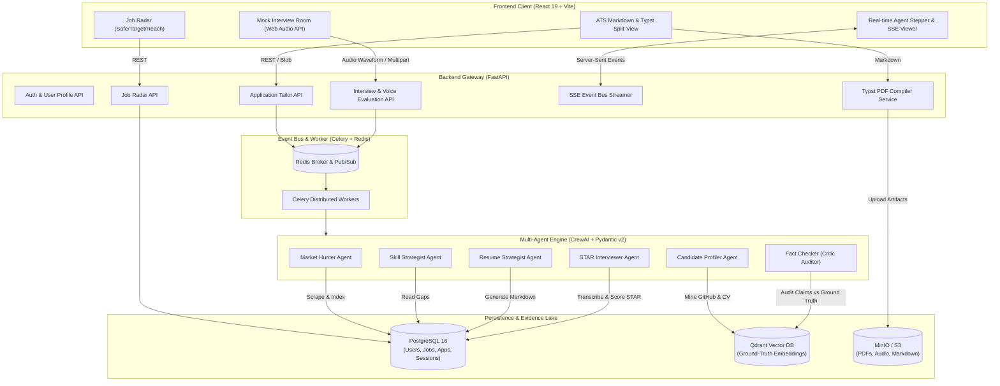
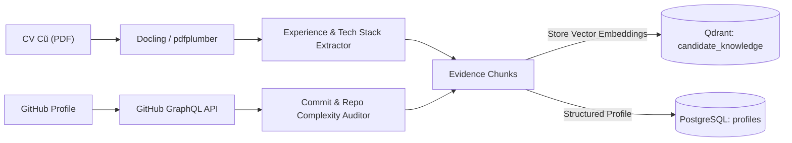
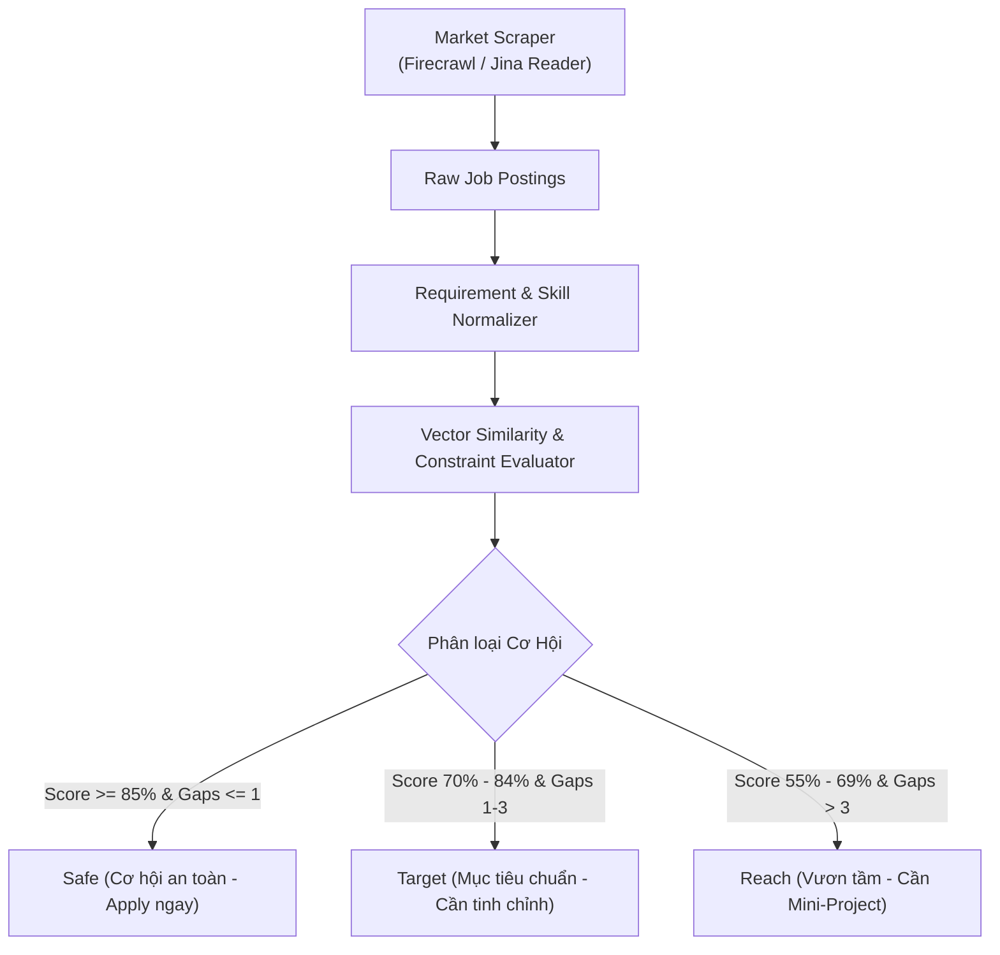
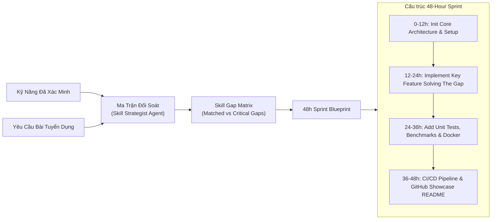
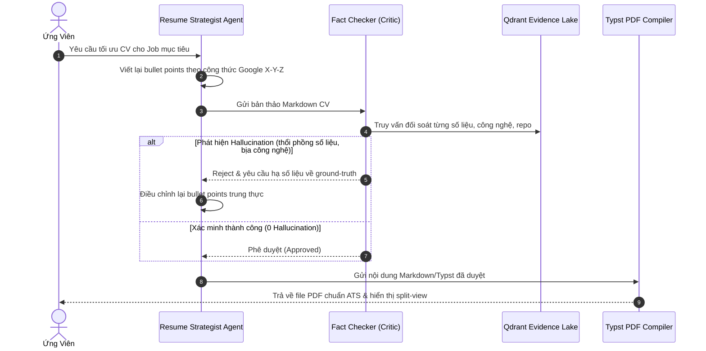
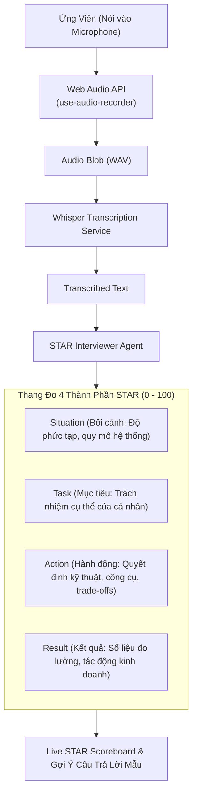
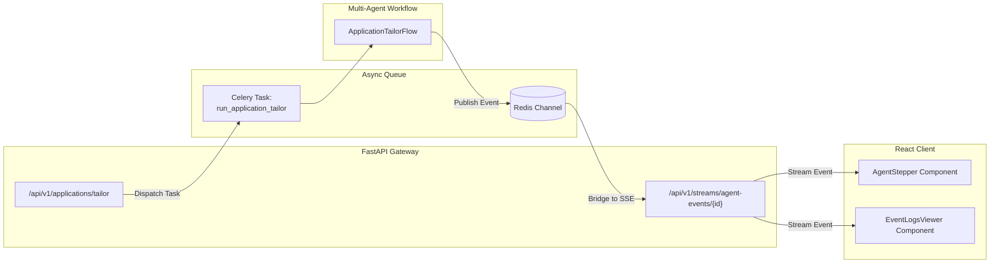

# CareerForge: Phân Tích Kiến Trúc & Chi Tiết Các Module Thành Phần

Tài liệu này phân tích chi tiết toàn diện 6 module nghiệp vụ cốt lõi và các lớp hạ tầng kỹ thuật của hệ thống **CareerForge** (*Autonomous AI Career Co-Pilot & Mock Interview Simulator*).

---

## 1. Sơ Đồ Kiến Trúc Tổng Thể (System Architecture)

---

## 2. Phân Tích Chi Tiết 6 Module Nghiệp Vụ Cốt Lõi

### Module 1: Profiling & Knowledge Grounding (Candidate Core & Evidence Lake)

Module này chịu trách nhiệm thu thập, xác minh và biến dữ liệu ứng viên thành **Ground-Truth Evidence** (bằng chứng thực tế không thể bịa đặt).

* **Thành phần & Trách nhiệm**:
  * **Document Parser (`tools/document_parser.py`)**: Sử dụng Docling/pdfplumber để trích xuất văn bản có cấu trúc từ CV PDF cũ (học vấn, công ty, vị trí, công nghệ).
  * **GitHub Miner (`tools/github_graphql.py`)**: Khai thác dữ liệu thực tế từ tài khoản GitHub: commit frequency, ngôn ngữ thường dùng, số sao, pull requests và cấu trúc thư mục của các repo ghim.
  * **Vector Grounding (`tools/vector_retriever.py`)**: Tách nhỏ kinh nghiệm thành các mẩu bằng chứng (Evidence Chunks) và lưu trữ embedding trong Qdrant. Đây là lớp bảo vệ (Safety Shield) ngăn chặn Agent bịa đặt dữ liệu ở các khâu sau.

---

### Module 2: Market Intelligence & Discovery Engine (Job Radar)

Module săn tìm và phân loại việc làm tự động theo ma trận năng lực của ứng viên.

* **Phân loại 3 nhóm việc làm (Job Tiers)**:
  1. **Safe (Điểm phù hợp $\ge 85\%$)**: Ứng viên đáp ứng hầu hết yêu cầu cốt lõi. Tỷ lệ qua vòng CV rất cao.
  2. **Target (Điểm phù hợp $70\% - 84\%$)**: Đúng năng lực định hướng nhưng khuyết 1-2 công nghệ phụ hoặc domain knowledge.
  3. **Reach (Điểm phù hợp $55\% - 69\%$)**: Vị trí mơ ước ở các công ty lớn hoặc level cao hơn (vd: Senior/Lead). Cần phải làm mini-project để bù đắp điểm yếu trước khi nộp.
* **Đặc tả dữ liệu**: Được chuẩn hóa thành `JobSchema` chứa requirements, salary range, tech stack và tags.

---

### Module 3: Actionable Upskilling (Skill Gap Matrix & 48h Mini-Project)

Biến điểm yếu thành hành động cụ thể thông qua mini-project có thể bổ sung ngay vào GitHub trong 48 giờ.

* **Đặc điểm nổi bật**:
  * Không đưa ra lời khuyên chung chung ("Hãy học Docker").
  * Đưa ra dự án có mã nguồn mẫu: Ví dụ nếu ứng viên khuyết kiến thức *Distributed LLM Serving*, hệ thống sẽ gợi ý: *"Xây dựng Reverse Proxy cân bằng tải cho vLLM cache engine bằng FastAPI & Redis"*.
  * Cung cấp timeline 4 mốc (0-12h, 12-24h, 24-36h, 36-48h) với tiêu chí nghiệm thu (Deliverables) rõ ràng.

---

### Module 4: Tailored Application Engine (Zero-Hallucination ATS CV & Typst)

May đo CV 1:1 cho từng bài tuyển dụng với cơ chế kiểm duyệt chặt chẽ 2 vòng.

* **Công thức định lượng Google X-Y-Z**:
  $$\text{Accomplished [X] as measured by [Y], by doing [Z]}$$
  * *Ví dụ*: *"Tối ưu hóa pipeline xử lý tài liệu giảm độ trễ p99 đi 35% bằng cách triển khai Redis cache cluster và Celery queue partitioning."*
* **Fact Checker (Critic Auditor)**:
  * Kiểm tra chéo với vector database Qdrant để đảm bảo mọi công nghệ, repo và số liệu xuất hiện trong CV đều có bằng chứng từ GitHub hoặc CV cũ của ứng viên.
* **Typst PDF Engine**:
  * Tốc độ biên dịch cực nhanh (<50ms), tạo PDF vector sắc nét, layout chuẩn ATS không bị lỗi font hay lỗi bảng biểu.

---

### Module 5: Interactive Mock Interview Simulator (STAR Real-Time Scoring)

Mô phỏng phòng phỏng vấn trực tiếp với AI Interviewer, hỗ trợ cả giọng nói (Voice) và văn bản.

* **Các chiều đánh giá STAR**:
  * **Situation (S)**: Ứng viên có nêu rõ bối cảnh kỹ thuật (scale, deadline, sự cố) không?
  * **Task (T)**: Phân biệt rõ việc của cả team vs vai trò cá nhân của ứng viên.
  * **Action (A)**: Đào sâu vào giải pháp kỹ thuật, lý do chọn kiến trúc A thay vì B, các trade-off đã cân nhắc.
  * **Result (R)**: Đòi hỏi kết quả định lượng (ví dụ: giảm $20\% latency, tiết kiệm \$10k chi phí hạ tầng).
* **Live Scoreboard**:
  * Hiển thị điểm số từng phần tức thì trên giao diện frontend cùng gợi ý cải thiện cụ thể.

---

### Module 6: Orchestration, Queue & Streaming Backbone

Xương sống kết nối luồng xử lý phân tán giữa FastAPI, Celery, Redis và giao diện React.

* **Celery + Redis**:
  * Tách biệt các tác vụ tốn thời gian (cào dữ liệu hàng trăm job, gọi LLM qua nhiều agent, render Typst) khỏi request-response lifecycle của FastAPI, tránh block I/O.
* **Server-Sent Events (SSE)**:
  * Frontend nhận luồng sự kiện theo thời gian thực (Step: *Market Hunter* $\to$ *Candidate Profiler* $\to$ *Skill Strategist* $\to$ *Resume Strategist* $\to$ *Fact Checker*).
  * Ứng viên nhìn thấy trực tiếp AI đang làm gì ở từng bước thay vì ngồi chờ màn hình loading vô định.

---

## 3. Ma Trận Dữ Liệu & Hợp Đồng Giao Tiếp Giữa Các Thành Phần

| Thành Phần | Input | Output | Công Nghệ / Thư Viện Chính |
| :--- | :--- | :--- | :--- |
| **Candidate Profiler** | CV PDF, GitHub Username | `CandidateProfileSchema` | Docling, PyGithub / GraphQL, Qdrant |
| **Market Hunter** | Profile keywords, Target roles | `List[JobSchema]` (Safe/Target/Reach) | Firecrawl, Jina Reader, BeautifulSoup |
| **Skill Strategist** | `CandidateProfileSchema`, `JobSchema` | `RoadmapPlanSchema` (Gap + 48h Sprint) | CrewAI, Pydantic v2 |
| **Resume Strategist** | `CandidateProfileSchema`, `JobSchema` | `TailoredResumeSchema` (Markdown) | CrewAI, Prompt Templates (X-Y-Z) |
| **Fact Checker** | `TailoredResumeSchema`, Evidence Lake | `AuditReport` (Approved/Revise) | Qdrant Cosine Similarity, Critic Agent |
| **Typst Compiler** | Markdown / Typst syntax | `resume.pdf` (Bytes) | Typst CLI, MinIO SDK |
| **STAR Interviewer** | Audio WAV / Text Answer | `StarEvaluationSchema` | Whisper, Web Audio API, CrewAI |
| **Event Streamer** | Agent Step Transitions | SSE Event Data Stream | FastAPI `StreamingResponse`, Redis Pub/Sub |

---

## 4. Các Điểm Cần Quyết Định Trong Khâu Triển Khai Tiếp Theo

> [!IMPORTANT]
> 1. **Mô hình LLM chủ đạo**: Bạn dự kiến sử dụng OpenAI (GPT-4o / GPT-4o-mini), Anthropic Claude 3.5 Sonnet, hay mô hình Open Source cục bộ (vLLM / Ollama)?
> 2. **Job Data Provider**: Thu thập qua API cào web (Firecrawl / Jina Reader) hay tích hợp trực tiếp nguồn API job board cụ thể (LinkedIn / Indeed / TopCV / ITviec)?
> 3. **Speech-to-Text Engine**: Sử dụng OpenAI Whisper Cloud API hay self-host `faster-whisper` trên Docker/GPU worker?
