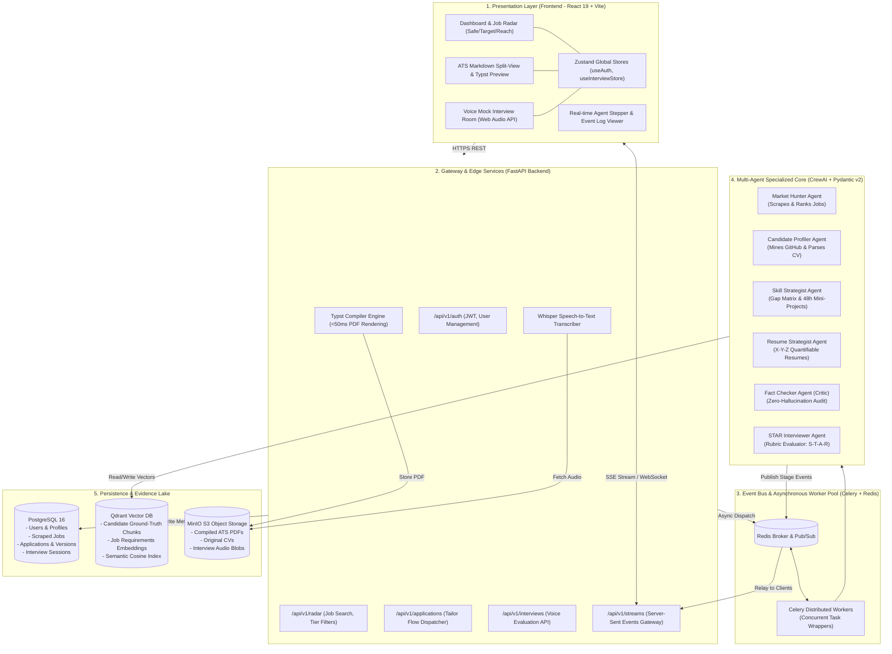
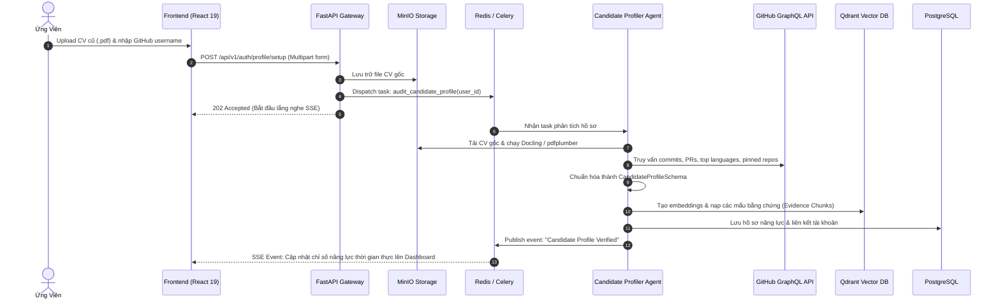
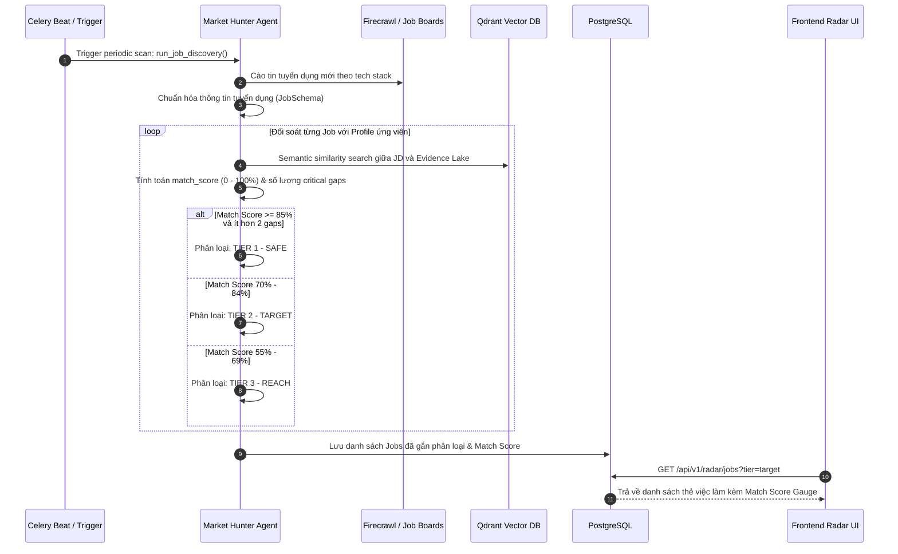
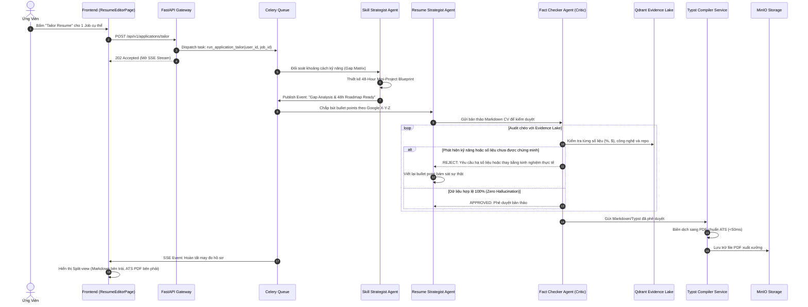
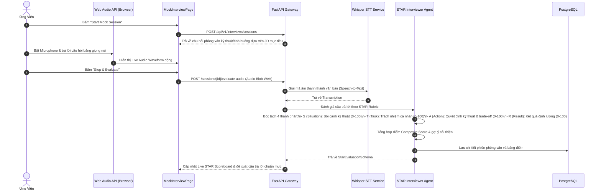
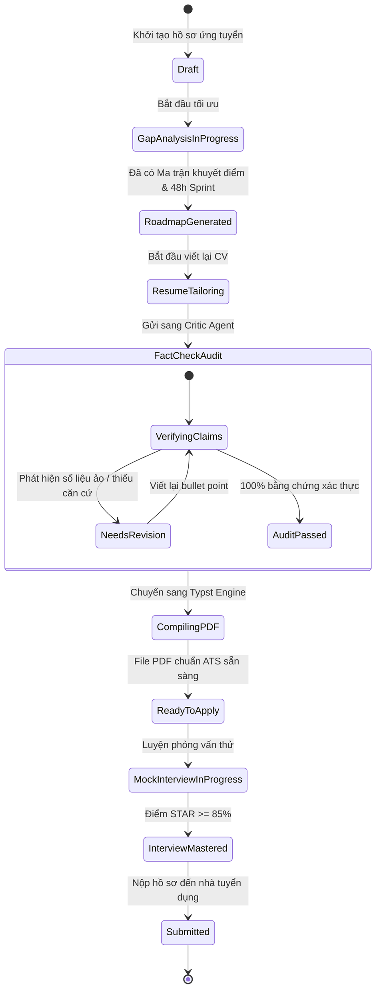

# CareerForge: Kiến Trúc Hệ Thống & Đặc Tả 4 Luồng Workflow Toàn Diện

Tài liệu này mô tả chi tiết **Kiến trúc hệ thống phân tầng (Layered System Architecture)** và **4 Luồng quy trình nghiệp vụ (End-to-End Workflows)** của nền tảng **CareerForge**.

---

## 1. Sơ Đồ Kiến Trúc Hệ Thống Đa Tầng (Layered System Architecture)

---

## 2. Đặc Tả 4 Luồng Workflow Nghiệp Vụ Cốt Lõi

### Workflow 1: Onboarding & Candidate Evidence Grounding Flow
> **Mục tiêu**: Xây dựng kho "Ground-Truth Evidence Lake" của ứng viên, ngăn chặn triệt để hiện tượng AI tự ý bịa đặt (hallucination) ở các bước sau.

---

### Workflow 2: Autonomous Job Radar Discovery & Ranking Flow
> **Mục tiêu**: Tự động săn tìm việc làm, phân tích ngữ nghĩa và xếp hạng cơ hội theo 3 tầng: **Safe**, **Target**, **Reach**.

---

### Workflow 3: Dual-Loop Resume Tailoring & Zero-Hallucination Audit Flow
> **Mục tiêu**: May đo CV 1:1 cho vị trí tuyển dụng mục tiêu theo công thức định lượng Google X-Y-Z, có Critic Agent kiểm toán chống thổi phồng số liệu, và xuất file Typst PDF.

---

### Workflow 4: Real-Time Audio Mock Interview & Live STAR Scoring Flow
> **Mục tiêu**: Mô phỏng phỏng vấn trực tiếp, ứng viên trả lời bằng giọng nói qua microphone, AI bóc tách giọng nói và chấm điểm 4 thành phần STAR tức thời.

---

## 3. Vòng Đời Trạng Thái Của Hồ Sơ (Application State Machine)

---

## 4. Tóm Tắt Các Điểm Kỹ Thuật Trọng Tâm Của Workflow

| Giai đoạn | Thách thức kỹ thuật | Giải pháp kiến trúc của CareerForge |
| :--- | :--- | :--- |
| **Grounding** | Ứng viên thổi phồng CV hoặc AI bịa đặt kinh nghiệm | Dùng Qdrant lưu trữ mẩu bằng chứng thực tế từ GitHub API và CV cũ để làm chốt kiểm duyệt bắt buộc |
| **Discovery** | Tin tuyển dụng tràn lan, khó xác định độ vừa sức | Phân 3 tầng minh bạch: Safe ($\ge 85\%$), Target ($70-84\%$), Reach ($55-69\%$) |
| **Actionable** | Lời khuyên học tập mơ hồ | Thiết kế 48h Mini-Project có mốc 12h/24h/36h/48h cụ thể để code bổ sung portfolio |
| **Tailoring** | Định dạng CV xuất ra bị lỗi font/bảng biểu khi qua ATS | Thay thế HTML/Word bằng **Typst Compiler**, render file PDF chuẩn ATS trong dưới 50ms |
| **Interview** | Phản hồi phỏng vấn chung chung, thiếu chiều sâu | Khung chấm điểm STAR 4 chiều độc lập kèm Live Scoreboard cập nhật tức thì |
